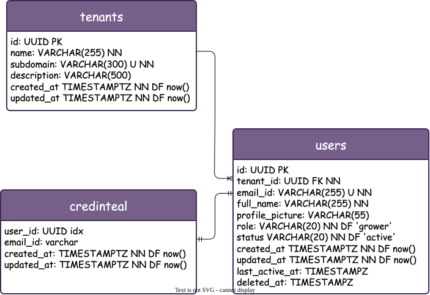
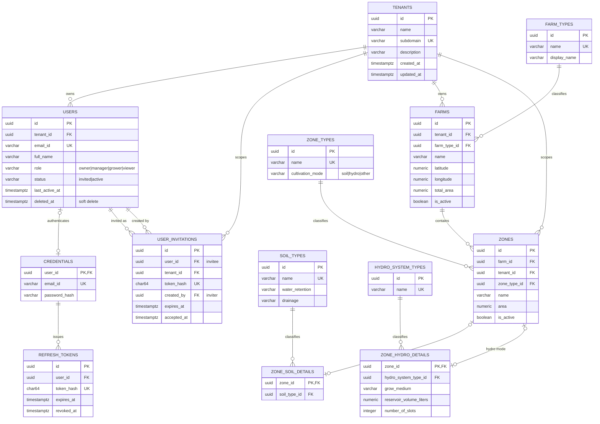

<div align="center">

# 🌱 FarmDeck

### The command deck for your farm 🚜

**Fields, hydro systems, daily logs, harvests & reports — a multi-tenant farm management SaaS
built with a Go backend and a React frontend.**

[](https://go.dev)
[](https://github.com/gin-gonic/gin)
[](https://react.dev)
[](https://vite.dev)
[](https://www.postgresql.org)
[](https://tailwindcss.com)
[](LICENSE)
[](.github/workflows)

[✨ Features](#-features) · 🏗️ [Architecture](#️-architecture) · 🚀 [Getting Started](#-getting-started) · 🗄️ [Database](#️-database) · 📡 [API](#-api-overview)

</div>

---

## 💡 What is FarmDeck?

FarmDeck is a **portfolio farm SaaS** — one workspace per tenant (farm organization), where
owners invite their team and manage everything about their operation in one place:

- 🗺️ **Farms & fields** — outdoor plots, greenhouses, indoor vertical racks
- 🌊 **Hydroponic zones** — NFT, DWC, aeroponics with system type & grow medium details
- 🟤 **Soil zones** — soil type, water retention & drainage profiles
- 🌱 **Crops & cycles** — catalog, planting cycles, daily logs *(frontend, backend in progress)*
- 🥕 **Harvests** — yield tracking per zone & cycle *(frontend, backend in progress)*
- 👥 **Team management** — role-based invites via email tokens
- 🌦️ **Weather** — map-picked coordinates ready for Open-Meteo forecasts *(planned)*

> 🧑‍🌾 **Philosophy:** farmers never type coordinates. Location is captured via an
> interactive satellite map picker with GPS & place-name search — all free, keyless services.

---

## ✨ Features

| | Feature | Details |
|---|---|---|
| 🔐 | **JWT auth with refresh rotation** | httpOnly cookies, SHA-256-hashed refresh tokens, revocation & device tracking (user-agent, IP) |
| 👥 | **Email invitation flow** | Tokenized invites (hashed, expiring, revocable) — owner invites, member accepts |
| 🛡️ | **Role-based access control** | `owner` · `manager` · `grower` · `viewer` — enforced by permission middleware on every route |
| 🏢 | **Multi-tenant from day one** | Tenant-scoped queries, cascade deletes, per-tenant unique farm/zone names |
| 🗺️ | **Map location picker** | Leaflet + OpenStreetMap & Esri satellite tiles, GPS button, Open-Meteo geocoding search |
| 🌗 | **Dark & light themes** | Themed UI via `next-themes` |
| 📊 | **Dashboard** | Live zone/crop/harvest overview per farm |
| 📚 | **OpenAPI / Swagger docs** | Auto-generated from code annotations at `/swagger/index.html` |
| 🐳 | **Dockerized + CI/CD** | Multi-stage builds, GitHub Actions pipelines for client & server |
| ⚡ | **Rate limiting** | Separate global & auth-specific token-bucket limits |

---

## 🏗️ Architecture

```
┌───────────────────────────┐          ┌────────────────────────────┐
│   🖥️  Frontend (SPA)      │          │   ⚙️  Backend (API)         │
│                           │  HTTP    │                            │
│  React 19 + Vite          │ ───────▶ │  Go 1.27 + Gin             │
│  Redux Toolkit / RTK Query│  JSON    │  Modular monolith          │
│  Tailwind 4 + shadcn/ui   │          │  ──────────────────────    │
│  Leaflet maps             │          │  auth · tenant · user      │
│                           │          │  farm · zone · lookup      │
└───────────────────────────┘          │  email (SMTP invitations)  │
                                       └────────────┬───────────────┘
                                                    │ pgx v5
                                                    ▼
                                       ┌────────────────────────────┐
                                       │  🐘 PostgreSQL 18          │
                                       │  goose migrations          │
                                       │  sqlc-generated queries    │
                                       └────────────────────────────┘
```

### 📂 Repository layout

```
farm-deck/
├── 📱 frontend/               # React 19 SPA (Vite, Tailwind 4, shadcn/ui)
│   └── src/features/          # auth · farms · zones · crops · daily-logs
│                              # harvests · dashboard · members · lookups
├── ⚙️ backend/                # Go API server (Gin, pgx, goose, sqlc)
│   ├── cmd/api/               # entrypoint + Swagger annotations
│   ├── internal/modules/      # feature modules (handler → service → store)
│   ├── internal/db/           # pgx pool, goose runner, sqlc-generated code
│   ├── db/migrations/         # SQL migrations (schema + rich seed data)
│   ├── db/queries/            # handwritten SQL for sqlc
│   ├── pkg/                   # jwt · password · ratelimit · mailer · slug
│   └── docs/                  # generated OpenAPI (swagger.json/yaml)
├── 📚 docs/                   # design docs + database diagrams
├── 🐳 .github/workflows/      # CI/CD — build, lint, deploy to GHCR
└── 📄 LICENSE                 # MIT
```

---

## 🛠️ Tech Stack

### ⚙️ Backend

| Tool | Purpose |
|---|---|
| [Go 1.27](https://go.dev) + [Gin](https://github.com/gin-gonic/gin) | HTTP framework & routing |
| [pgx v5](https://github.com/jackc/pgx) | High-performance PostgreSQL driver |
| [goose](https://github.com/pressly/goose) | SQL migrations |
| [sqlc](https://sqlc.dev) | Type-safe SQL → Go code generation |
| [golang-jwt v5](https://github.com/golang-jwt/jwt) | Access & refresh tokens |
| [go-mail](https://github.com/wneessen/go-mail) | SMTP invitation emails |
| [swaggo](https://github.com/swaggo/swag) | OpenAPI docs from annotations |
| [rate limit](https://pkg.go.dev/golang.org/x/time/rate) | Token-bucket rate limiting |

### 🖥️ Frontend

| Tool | Purpose |
|---|---|
| [React 19](https://react.dev) + [Vite 8](https://vite.dev) | UI & build tooling |
| [Redux Toolkit](https://redux-toolkit.js.org) + RTK Query | State & data fetching/caching |
| [Tailwind CSS 4](https://tailwindcss.com) + [shadcn/ui](https://ui.shadcn.com) | Styling & component system |
| [TanStack Table](https://tanstack.com/table) | Data grids (farms, members, logs) |
| [react-hook-form](https://react-hook-form.com) | Form validation |
| [Leaflet](https://leafletjs.com) + [react-leaflet](https://react-leaflet.js.org) | Interactive farm maps |
| [date-fns](https://date-fns.org) · [sonner](https://sonner.emilkowal.ski) · [next-themes](https://github.com/pacocoursey/next-themes) | Dates · toasts · theming |

---

## 🗄️ Database

13 tables, multi-tenant with cascade deletes, partial unique indexes for soft-archived rows,
and CHECK constraints guarding data quality (lat/lng ranges, positive areas, role enums).



> 📌 High-resolution [PNG](docs/db_diagram.png) · editable [draw.io source](docs/db_diagram.drawio) · full [Mermaid ER diagram with relationship table](docs/db_er_diagram.md)

<details>
<summary>📊 <b>Click to expand — Mermaid ER diagram</b></summary>



</details>

---

## 🔐 Roles & Permissions

| Permission | 👑 Owner | 🧑‍💼 Manager | 🧑‍🌾 Grower | 👀 Viewer |
|---|:---:|:---:|:---:|:---:|
| Members — view / manage | ✅ | ✅ | ➖ | ➖ |
| Workspace settings | ✅ | ➖ | ➖ | ➖ |
| Farms — view / manage | ✅ | ✅ | ✅ | 👁️ view |
| Fields (zones) — view / manage | ✅ | ✅ | ✅ | 👁️ view |
| Crops — view / manage | ✅ | ✅ | ✅ | 👁️ view |
| Harvests — view / log | ✅ | ✅ | ✅ | 👁️ view |

---

## 📡 API Overview

Base URL: `http://localhost:8083/api/v1` · Interactive docs: [`/swagger/index.html`](http://localhost:8083/swagger/index.html)

| Method | Endpoint | Description | 🔒 |
|---|---|---|:---:|
| `POST` | `/auth/register` | Create owner + tenant (first signup) | — |
| `POST` | `/auth/login` | Login → sets JWT cookies | — |
| `POST` | `/auth/refresh` | Rotate refresh token | 🍪 |
| `POST` | `/auth/logout` | Revoke session | 🍪 |
| `GET` | `/auth/verify-invitation` | Validate an invite token | — |
| `POST` | `/auth/accept-invitation` | Accept invite & set password | — |
| `GET` `PATCH` | `/users/me` | Current profile | 🍪 |
| `GET` `POST` `PATCH` `DELETE` | `/users/members` | Team member CRUD | 🍪 |
| `PATCH` | `/tenants/me` | Update workspace | 🍪 |
| `GET` `POST` | `/farms` | List / create farms | 🍪 |
| `PUT` `PATCH` | `/farms/:id` · `/farms/:id/activate` | Update / (de)activate | 🍪 |
| `GET` `POST` `PUT` | `/zones` · `/zones/:id` | List / create / update zones | 🍪 |
| `GET` | `/lookups/*` | Farm, zone, soil & hydro system types | 🍪 |
| `GET` | `/health` | Liveness probe | — |

🔒 = requires auth cookie · 🍪 = httpOnly JWT

---

## 🚀 Getting Started

### 📋 Prerequisites

- 🐹 **Go 1.27+**
- 🟢 **Node 22+** & npm
- 🐘 **PostgreSQL 18** (any 15+ works) — e.g. `docker run -d --name postgres18 -e POSTGRES_PASSWORD=12345 -p 5432:5432 postgres:18`
- 🛠️ `goose`, `sqlc`, `swag` CLIs (optional — only for migrations/codegen)

### ⚙️ Backend

```bash
cd backend

# 1️⃣ Configure environment
cp configs/.env.example configs/.env        # edit JWT_SECRET & SMTP creds

# 2️⃣ Create the database (inside your postgres container)
make create-db

# 3️⃣ Run — migrations apply automatically on boot 🪄
make dev
```

🎉 API live at `http://localhost:8083` — Swagger at `/swagger/index.html`

### 🖥️ Frontend

```bash
cd frontend
npm install
npm run dev
```

🎉 App live at `http://localhost:5173`

### 🧰 Make targets (backend)

| Target | Action |
|---|---|
| `make dev` | Run API server (`go run`) |
| `make build` | Compile binary to `bin/api` |
| `make test` | Run all Go tests |
| `make migrate-up` / `migrate-down` | Apply / roll back migrations |
| `make migrate-create name=x` | Scaffold a new migration |
| `make sqlc` | Generate Go from SQL |
| `make swagger` | Regenerate OpenAPI docs |
| `make docker-build` / `docker-run` | Build & run the server container on `:8083` |

---

## 🐳 Docker & CI/CD

- **Backend** — multi-stage `Dockerfile` (distroless-style Alpine, non-root `app` user) → `ghcr.io/<owner>/farm-deck-server`
- **Frontend** — build → nginx serve → `ghcr.io/<owner>/farm-deck-client`
- **GitHub Actions** — [deploy-server.yml](.github/workflows/deploy-server.yml) & [deploy-client.yml](.github/workflows/deploy-client.yml) lint, build & push on `main` (path-filtered, queued, never cancelled mid-flight)

---

## 🗺️ Roadmap

- [x] ✅ Multi-tenant schema, auth, invitations, RBAC
- [x] ✅ Farms & zones CRUD (soil + hydro detail tables)
- [x] ✅ Map picker — GPS, satellite tiles, place search (keyless)
- [ ] ⬜ Crops, cycles, daily logs & harvests — backend modules
- [ ] ⬜ Weather cards via Open-Meteo (farm coordinates → forecast cache)
- [ ] ⬜ Reminders & reports

---

## 🤝 Contributing

PRs welcome! Please keep the module structure (`handler → service → store`), run `make test`
and `npm run lint`, and regenerate `sqlc` / `swagger` output when touching queries or annotations.

## 📄 License

Released under the **MIT License** — see [LICENSE](LICENSE).

<div align="center">

**⭐ If FarmDeck helped you, star the repo! ⭐**

Made with 🌱 and ❤️ for farmers

</div>
