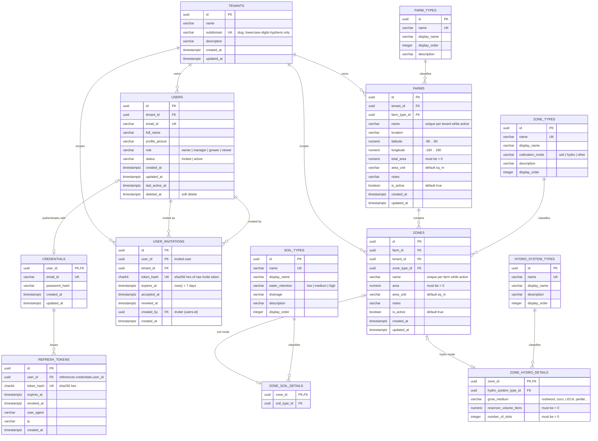

# FarmDeck — Database ER Diagram

Generated from [`backend/db/migrations/000001_init_schema.sql`](../backend/db/migrations/000001_init_schema.sql).
Migrations `000002`–`000004` are seed data only (tenants, users, lookups, farms/zones) and add no schema.

## Relationship summary

| Parent | Child | Cardinality | FK | ON DELETE |
|---|---|---|---|---|
| tenants | users | 1 → N | `users.tenant_id` | CASCADE |
| users | credentials | 1 → 0..1 | `credentials.user_id` (PK) | CASCADE |
| credentials | refresh_tokens | 1 → N | `refresh_tokens.user_id` | CASCADE |
| tenants | user_invitations | 1 → N | `user_invitations.tenant_id` | CASCADE |
| users | user_invitations | 1 → N | `user_invitations.user_id` (invitee) | CASCADE |
| users | user_invitations | 1 → N | `user_invitations.created_by` (inviter) | NO ACTION |
| tenants | farms | 1 → N | `farms.tenant_id` | CASCADE |
| farm_types | farms | 1 → N | `farms.farm_type_id` | NO ACTION |
| tenants | zones | 1 → N | `zones.tenant_id` | CASCADE |
| farms | zones | 1 → N | `zones.farm_id` | CASCADE |
| zone_types | zones | 1 → N | `zones.zone_type_id` | NO ACTION |
| zones | zone_soil_details | 1 → 0..1 | `zone_soil_details.zone_id` (PK) | CASCADE |
| soil_types | zone_soil_details | 1 → N | `zone_soil_details.soil_type_id` | NO ACTION |
| zones | zone_hydro_details | 1 → 0..1 | `zone_hydro_details.zone_id` (PK) | CASCADE |
| hydro_system_types | zone_hydro_details | 1 → N | `zone_hydro_details.hydro_system_type_id` | NO ACTION |

## Notes

- **Multi-tenancy**: `tenants` is the root; users, farms, zones, and invitations all denormalize `tenant_id` for scoped queries and cascade deletes.
- **Zone detail tables are exclusive by cultivation mode**: `zone_types.cultivation_mode` (`soil` / `hydro` / `other`) drives which detail table is used; `other` modes (aquaponic, mushroom) use neither.
- **Composite-FK anchor (D11)**: `zones` has `UNIQUE (id, farm_id)` so detail/log tables can reference `(zone_id, farm_id)` composite foreign keys in future migrations.
- **Soft delete / soft archive**: `users.deleted_at` soft-deletes users; `farms.is_active` / `zones.is_active` archive records, with partial unique indexes enforcing name uniqueness only among live rows.
- **Lookup tables** (`farm_types`, `zone_types`, `soil_types`, `hydro_system_types`) are seeded in `000003_seed_lookup.sql` and referenced with `NO ACTION` deletes.
